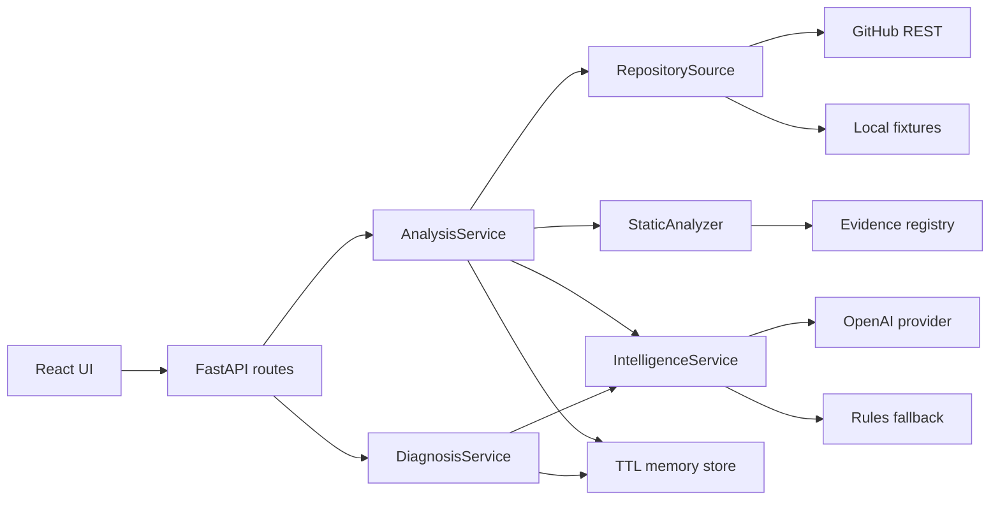

# RepoDoctor — архитектура MVP и единый контракт реализации

Версия документа: 1.0. Дата: 25 октября 2026. Статус: спецификация будущей реализации.

Этот документ — источник истины для четырёх агентов. Имена полей, endpoint-ов, модулей и статусов ниже нормативные. Изменения общих контрактов проходят через агента 1 и отражаются во всех затронутых клиентах и fixtures в одной интеграции.

## 1. Что строим и как оцениваем результат

Пользователь вводит URL публичного GitHub-репозитория, выбирает ОС и shell, получает сведения о проекте, список ограничений, пошаговую инструкцию и риски. Затем вставляет ошибку из своего терминала и получает вероятные причины, проверяемые способы исправления и команды проверки.

Четыре агента из roadmap — **агенты-разработчики**. В самом RepoDoctor нет четырёх автономных LLM-агентов: это управляемый конвейер из загрузчика, детерминированных анализаторов и AI-сервиса. Такая реализация сохраняет цель продукта и уменьшает риск сорвать хакатон на оркестрации.

### Обязательные пользовательские функции

| ID | Функция | Что считается готовым |
|---|---|---|
| F01 | Ввод GitHub URL | Проверяются host, owner/repo; полезная ошибка для неподдерживаемого URL |
| F02 | Выбор окружения | Windows/PowerShell, Linux/bash, macOS/zsh; выбранное окружение видно в отчёте |
| F03 | Чтение репозитория | Метаданные, commit SHA, дерево и отобранные текстовые файлы одного commit |
| F04 | Разбор стека | Python/npm/mixed/unknown; manifest-файлы, зависимости, scripts, версии runtime |
| F05 | Риски запуска | Отсутствующие инструкции, неизвестный runtime, неоднозначный manager, данные/env/GPU, неполный анализ |
| F06 | План запуска | Порядок шагов, рабочая директория, команды, источники, проверки и допущения |
| F07 | Диагностика ошибки | Вставленный лог + контекст анализа → причины, исправления, проверки, вопросы при нехватке данных |
| F08 | Просмотр доказательств | Путь, строки или факт из дерева, ссылка на неизменяемый commit |
| F09 | Экспорт | Markdown текущего отчёта и последней диагностики, без исходного лога и секретов |
| F10 | Надёжная демонстрация | Offline fixture-сценарий, настоящий GitHub-сценарий, отдельно AI live/fallback |
| F11 | Понятные сбои | 404, rate limit, timeout, слишком большой ввод, недоступный AI, истёкший анализ |

### Границы

- Глубокая поддержка: `requirements*.txt`, `pyproject.toml`, `package.json`, README, `.env.example`, `.python-version`, `.nvmrc`, `.node-version`. Вложенные проекты анализируются в ограниченном числе.
- Поверхностная поддержка: `environment.yml`, `Dockerfile`, compose, shell-скрипты, lock-файлы, notebooks и CI как сигналы наличия. Не обещать полноценную проверку всех ecosystem.
- Не входят: запуск/починка кода на сервере, установка зависимостей чужого репозитория, создание PR, изменение чужих файлов, приватные репозитории, GitLab, авторизация пользователей, GPU-среда, RAG/vector DB, web search моделью, рекурсивная загрузка submodules, автоматическое скачивание датасетов.
- Не проверяем актуальность каждой версии пакета через registry и не объявляем пакет устаревшим только потому, что версия закреплена. Не заявляем, что CUDA подходит пользователю, что данные доступны или что запуск проверен.
- MVP локальный/для одного демонстрационного стенда. Публичный многопользовательский SaaS потребует авторизации, квот, постоянного хранилища и отдельной модели доступа.

## 2. Компоненты и поток данных



### Анализ

1. `POST /api/v1/analyses`: валидировать ввод, занять слот операции, нормализовать URL.
2. Источник возвращает `RepositorySnapshot`: публичные metadata → resolved commit → tree → ограниченный набор blobs. В fixture-режиме тот же тип получается с диска.
3. Scanner строит `RepositoryFacts`, evidence registry, findings и coverage.
4. IntelligenceService создаёт `RunPlan`, добавляет только валидированные AI-находки. При недоступном AI возвращает статический fallback.
5. API формирует `AnalysisResponse`, сохраняет `AnalysisContext` в memory store, возвращает `201`.
6. UI показывает отчёт, происхождение данных, качество плана и возможность вставить лог.

### Диагностика

1. `POST /api/v1/analyses/{analysis_id}/diagnoses`: проверить ID, TTL, длину лога и согласие на отправку обработанного текста AI.
2. Удалить ANSI-коды, нормализовать переводы строк, замаскировать секреты и credential URL. Сохранить номера строк обработанного лога.
3. Правила находят сигнатуры ошибок. Модель, если разрешена, получает ограниченный контекст сохранённого анализа и обработанный лог.
4. Валидировать причины, ссылки, команды, принадлежность shell и пути; при сбое вернуть полезный fallback.
5. Вернуть `200`. Сырой лог не писать в store, application logs или fixtures; UI держит его только в памяти текущей страницы.

## 3. Стек и зависимости

Это целевой стек, а не утверждение, что зависимости уже установлены. `G0` фиксирует точные совместимые версии в lock-файлах; после этого никто не ставит `latest` и не меняет major без общего решения.

| Слой | Библиотеки / инструменты | Назначение и ограничения |
|---|---|---|
| Runtime backend | Python 3.12.x | `tomllib`, `asyncio`, `ast`, `re`, `json`, `pathlib`, `urllib.parse`, `hashlib`, `uuid`, `datetime`, `time`, `logging` из stdlib |
| API | FastAPI, Uvicorn | REST, lifespan, DI; один worker |
| Контракты/config | Pydantic 2, pydantic-settings 2 | DTO, валидация, переменные окружения |
| HTTP | httpx | async GitHub-клиент, лимиты, transport mocks |
| AI | openai Python SDK | `AsyncOpenAI`, Responses API, структурированный ответ; модель через конфигурацию |
| Python manifests | packaging | `Requirement`, `SpecifierSet`, проверка объявленных ограничений; не dependency resolver |
| Python dev | pytest, pytest-asyncio, Ruff | Unit/integration проверки и lint |
| Python packaging | uv, hatchling | `pyproject.toml`, `uv.lock`, воспроизводимая сборка/install |
| Runtime frontend | Node.js 22, не ниже 22.12; npm | Точную patch-версию фиксировать в `.nvmrc` после smoke |
| UI | React 19, react-dom 19, TypeScript | Компоненты, hooks, строгие типы |
| Build | Vite 7, @vitejs/plugin-react совместимой версии | Осознанная базовая версия, не заявление о самой новой; точные версии в package-lock |
| API-типы | openapi-typescript | Генерация `generated.ts` из OpenAPI backend; не ручные копии DTO |
| Frontend tests | Vitest, jsdom, @testing-library/react, @testing-library/user-event, @testing-library/jest-dom | Формы и состояния, настоящий поведенческий тест |
| Network mocks | MSW | Только dev/tests, согласованные с контрактами JSON fixtures |
| Browser tests | @playwright/test | Сквозные проверки, браузер Chromium устанавливается отдельно |
| CI/deploy | GitHub Actions, Docker, Docker Compose | Контейнер RepoDoctor, не контейнеризация анализируемых проектов |

Без SQLAlchemy, Redis, Celery, LangChain, LangGraph, pandas, Tailwind, axios и router: для одного экрана и ограниченного конвейера они не нужны. HTTP frontend — встроенный `fetch`, UI — обычный CSS, экспорт Markdown — собственная короткая функция. YAML не исполняется и не парсится в MVP, используется как ограниченный текстовый сигнал; библиотека PyYAML не нужна.

## 4. Структура проекта и владение

```text
RepoDoctor/
├── README.md                         # A1: итоговый запуск и обзор
├── ARCHITECTURE.md                   # A1: источник контрактов
├── ROADMAP.md                       # A1: очередь интеграции и gates
├── agents/                          # задания четырём агентам
├── .env.example                     # A1: только имена и безопасные значения
├── .gitignore                       # A1
├── .nvmrc                           # A4
├── Dockerfile                       # A1: frontend build + backend runtime
├── compose.yaml                     # A1
├── .github/workflows/ci.yml          # A1
├── contracts/
│   ├── openapi.json                 # A1: генерируется из backend
│   └── examples/                    # A1: нормативные request/response JSON
├── docs/
│   ├── decisions.md                 # A1: решения и contract changes
│   ├── runbook.md                   # A1: запуск, диагностика самого RepoDoctor
│   ├── demo.md                      # A4: сценарий защиты
│   └── handoffs/                    # каждый пишет только agent_N.md
├── backend/
│   ├── pyproject.toml               # A1: все Python зависимости
│   ├── uv.lock                      # A1
│   ├── src/repodoctor/
│   │   ├── main.py                  # A1: app factory/lifespan/static
│   │   ├── config.py                # A1
│   │   ├── contracts/               # A1: api.py, domain.py, ports.py
│   │   ├── api/                     # A1: routes.py, errors.py, dependencies.py
│   │   ├── services/                # A1: analysis.py, diagnosis.py, store.py
│   │   ├── security/                # A1: redaction.py, limits.py
│   │   ├── repository/              # A2: url.py, github.py, source.py, selection.py
│   │   ├── scanners/                # A2: python.py, node.py, readme.py, risks.py, analyzer.py
│   │   ├── intelligence/            # A3: service.py, provider.py, context.py, validation.py
│   │   │   ├── rules.py             # A3: лог и fallback-план
│   │   │   └── prompts/             # A3: analysis.txt, diagnosis.txt
│   │   └── static/                  # generated frontend build; не редактировать
│   └── tests/
│       ├── platform/                # A1
│       ├── repository/              # A2
│       ├── intelligence/            # A3
│       └── integration/             # A1, A3 передаёт сценарии через handoff
├── fixtures/
│   ├── repositories/                # A2: безопасные синтетические snapshots
│   └── intelligence/                # A3: обезличенные модельные ответы и логи
└── frontend/                        # A4 целиком
    ├── package.json
    ├── package-lock.json
    ├── vite.config.ts
    ├── playwright.config.ts
    ├── src/
    │   ├── App.tsx
    │   ├── api/client.ts
    │   ├── api/generated.ts         # generated, не править руками
    │   ├── components/             # формы, карточки, evidence, шаги
    │   ├── hooks/                  # useAnalysis, useDiagnosis
    │   ├── lib/exportMarkdown.ts
    │   ├── mocks/                  # MSW; не включать в production
    │   └── styles.css
    └── tests/                      # unit и e2e
```

Не создавать вложенный каталог `RepoDoctor`, если текущая рабочая папка уже является корнем проекта. Дерево выше обозначает корень логически.

## 5. Контракты: общие правила

Все public DTO объявляются в `contracts/api.py`, внутренние DTO — в `domain.py`, Protocol-интерфейсы — в `ports.py`. Pydantic `extra='forbid'`. JSON — snake_case. Время — UTC ISO 8601 с `Z`. ID анализа/диагностики — UUID4. Evidence ID уникален внутри ответа, finding ID стабилен по правилу/пути. Нельзя возвращать произвольный Python exception в API.

Обозначения ниже: `T?` — обязательное поле JSON со значением `T | null`; `T[]` — массив, в том числе пустой. Все перечисленные поля обязательны, кроме явно описанных defaults входного запроса. Для модельных схем не использовать произвольные словари: предпочтительны массивы типизированных объектов, все поля required, nullable при отсутствии значения.

### Перечисления

```text
TargetOS = windows | linux | macos
Shell = powershell | bash | zsh
Stack = python | node | mixed | unknown
Severity = info | warning | blocker
Confidence = low | medium | high
Origin = static | ai
EvidenceSource = file | tree | log
CoverageStatus = complete | partial
PlanStatus = actionable | needs_input
GenerationMode = ai | fallback
SourceMode = github | fixture
```

`complete` означает «выполнен предусмотренный ограниченный отбор», а не «прочитан каждый файл». `blocker` означает выявленное препятствие для предложенного пути запуска, а не доказательство невозможности запуска вообще.

### Общие DTO

| Тип | Поля |
|---|---|
| TargetEnvironment | `os: TargetOS`, `shell: Shell` |
| Evidence | `id: str`, `source: EvidenceSource`, `path: str?`, `line_start: int?`, `line_end: int?`, `excerpt: str`, `url: str?` |
| Finding | `id: str`, `rule_id: str`, `title: str`, `description: str`, `severity: Severity`, `confidence: Confidence`, `origin: Origin`, `evidence_ids: str[]`, `suggested_action: str` |
| Command | `shell: Shell`, `text: str`, `cwd: str`, `explanation: str`, `requires_review: bool` |
| RunStep | `id: str`, `title: str`, `description: str`, `commands: Command[]`, `evidence_ids: str[]`, `verification: str`, `assumptions: str[]` |
| RunPlan | `status: PlanStatus`, `summary: str`, `prerequisites: str[]`, `steps: RunStep[]`, `questions: str[]` |
| Coverage | `status: CoverageStatus`, `tree_entries_seen: int`, `files_selected: int`, `files_read: int`, `bytes_read: int`, `limitations: str[]` |
| GenerationInfo | `mode: GenerationMode`, `reason: str?`, `model: str?`, `prompt_version: str` |
| RepositoryInfo | `owner: str`, `name: str`, `url: str`, `default_branch: str`, `resolved_commit: str`, `description: str?` |
| Dependency | `name: str`, `constraint: str?`, `ecosystem: python|node`, `kind: runtime|dev|optional`, `manifest_path: str`, `evidence_ids: str[]` |
| RuntimeHint | `runtime: python|node`, `constraint: str`, `evidence_ids: str[]` |
| PackageManagerHint | `name: pip|uv|poetry|npm|yarn|pnpm|conda`, `root: str`, `evidence_ids: str[]` |
| EntryPoint | `root: str`, `command_hint: str`, `kind: readme|script|module|file`, `evidence_ids: str[]` |
| ProjectRoot | `path: str`, `stack: Stack`, `manifest_paths: str[]` |
| RepositoryFacts | `stack: Stack`, `project_roots: ProjectRoot[]`, `dependencies: Dependency[]`, `runtime_hints: RuntimeHint[]`, `package_managers: PackageManagerHint[]`, `entrypoints: EntryPoint[]`, `env_var_names: str[]`, `data_hints: str[]`, `gpu_hints: str[]` |

Пути repo-relative, POSIX, без начального `/` и `..`; корень — `.`. `Command.cwd` описывает локальную рабочую папку пользователя: `.` до клонирования, `<repo>` и `<repo>/subdir` после него. Это маркированные обозначения, которые UI объясняет; сервер не передаёт их shell. В `text` команды подставляется реальное безопасно процитированное имя repo, не маркер `<repo>`.

Evidence: `file` имеет path + реальные строки прочитанного файла; `tree` имеет path, null-строки и краткий факт; `log` имеет path=null, url=null и строки обработанного лога. Excerpt ≤500 символов после redaction. URL формируется сервером из canonical repo/commit/path; модель не задаёт URL. ID ссылок модели должны принадлежать registry. Для отсутствующего файла доказательство — manifest/README, где он упомянут, и ограничение tree completeness; нельзя ссылаться на несуществующие строки.

### HTTP-контракт

#### `GET /api/v1/health` → 200

`HealthResponse {status: 'ok', version: str, repository_mode: 'live'|'fixture', ai_configured: bool}`. Это liveness + конфигурация, не проверка доступа к внешним API. Не возвращать значения ключей.

#### `POST /api/v1/analyses` → 201

`AnalysisRequest {repo_url: str, ref: str? = null, target: TargetEnvironment, use_ai: bool = true}`.

ОС/shell разрешены только парами windows/powershell, linux/bash, macos/zsh. URL ≤2048 символов. `ref` ≤200 символов, без control characters; может быть branch/tag/commit и передаётся как **один URL-encoded path segment** GitHub API, никогда shell-аргументом. Пустой ref нормализуется в null.

`AnalysisResponse {schema_version: '1.0', analysis_id: str, created_at: str, expires_at: str, source_mode: SourceMode, repository: RepositoryInfo, target: TargetEnvironment, facts: RepositoryFacts, coverage: Coverage, findings: Finding[], evidence: Evidence[], run_plan: RunPlan, generation: GenerationInfo, warnings: str[]}`.

#### `POST /api/v1/analyses/{analysis_id}/diagnoses` → 200

`DiagnosisRequest {log: str, command: str? = null, use_ai: bool = true}`.

Лог: 1–30 000 символов, whitespace-only запрещён. command ≤2000 символов. Environment берётся из анализа, менять его молча нельзя. Введённая пользователем command также проходит redaction и не исполняется.

`DiagnosisCause {id: str, title: str, explanation: str, confidence: Confidence, origin: Origin, evidence_ids: str[], fixes: RunStep[], verification: str}`.

`DiagnosisResponse {schema_version: '1.0', diagnosis_id: str, analysis_id: str, created_at: str, generation: GenerationInfo, summary: str, causes: DiagnosisCause[], questions: str[], evidence: Evidence[], warnings: str[]}`.

`evidence` диагностики содержит объединённые доказательства repo и обработанного лога, нужные для всех causes/fixes. Не ссылаться на evidence, существующий лишь в другом HTTP-ответе. ID repo-evidence сохранять, log-evidence использовать префикс `log_`.

#### Ошибки

Все ошибки, включая FastAPI validation и переполнение body: `ErrorResponse {error: {code: str, message: str, retryable: bool, details: str[], request_id: str}}`. `details` содержит только безопасные пояснения, без исходного лога, auth headers и локальных секретов.

| HTTP | code | Смысл |
|---|---|---|
| 422 | INVALID_INPUT | URL, shell, ref, пустой лог, invalid UUID |
| 404 | REPOSITORY_NOT_FOUND | Репозиторий не существует или недоступен |
| 404 | REF_NOT_FOUND | Repo есть, ref не найден |
| 404 | ANALYSIS_NOT_FOUND | Неизвестный ID, рестарт, TTL или eviction; UI предлагает повторить анализ |
| 409 | EMPTY_REPOSITORY | Нет commit/tree |
| 413 | PAYLOAD_TOO_LARGE | HTTP body превысил 128 KiB |
| 422 | UNSUPPORTED_REPOSITORY | Private repo или неподдерживаемый источник |
| 429 | SERVER_BUSY | Достигнут лимит одновременных операций |
| 429 | GITHUB_RATE_LIMITED | Primary/secondary limit, корректный Retry-After если доступен |
| 502 | GITHUB_UNAVAILABLE | Внешний сервис недоступен или ответ невалиден |
| 504 | ANALYSIS_TIMEOUT | Общий deadline операции истёк |
| 500 | INTERNAL_ERROR | Безопасное сообщение, request_id для server logs |

Отказ AI **после успешного scan** — 201/200 с `generation.mode='fallback'` и объяснением; не терять полезный результат из-за генерации. `use_ai=false` также даёт fallback, reason=`disabled_by_user`.

## 6. Внутренние типы и интерфейсы

```python
# Сигнатуры нормативные; DTO подробно определены ниже.
class RepositorySource(Protocol):
    async def fetch(self, request: AnalysisRequest) -> RepositorySnapshot: ...

class StaticAnalyzer(Protocol):
    def analyze(self, snapshot: RepositorySnapshot) -> StaticAnalysis: ...

class IntelligenceService(Protocol):
    async def build_plan(self, scan: StaticAnalysis, target: TargetEnvironment,
                         use_ai: bool) -> PlanResult: ...
    async def diagnose(self, context: AnalysisContext, log: SanitizedLog,
                       command: str | None, use_ai: bool) -> DiagnosisResult: ...

class AnalysisStore(Protocol):
    def put(self, context: AnalysisContext) -> None: ...
    def get(self, analysis_id: str) -> AnalysisContext | None: ...
    def purge_expired(self) -> int: ...
```

Внутренние DTO:

- `TreeEntry(path, type, mode, sha, size: int|null)`; все string-поля — из GitHub, но перед использованием проверяются. Не принимать symlink `120000` и submodule `160000` за обычный файл.
- `TextFile(path, content, size_bytes, sha)`; content уже очищен от секретов с сохранением числа строк; `size_bytes` — исходный декодированный размер до redaction.
- `RepositorySnapshot(repository: RepositoryInfo, source_mode: SourceMode, tree: list[TreeEntry], files: list[TextFile], coverage: Coverage)`.
- `StaticAnalysis(repository: RepositoryInfo, source_mode: SourceMode, facts: RepositoryFacts, findings: list[Finding], evidence: list[Evidence], coverage: Coverage, selected_files: list[TextFile])`.
- `PlanResult(run_plan: RunPlan, additional_findings: list[Finding], evidence: list[Evidence], generation: GenerationInfo, warnings: list[str])`; evidence — подмножество существующего registry, AI не создаёт вымышленных file-evidence.
- `AnalysisContext(response: AnalysisResponse, scan: StaticAnalysis)`; snapshot tree целиком не хранится, selected_files ограничены суммарным бюджетом.
- `SanitizedLog(text: str, redactions_count: int, truncated: bool)`; вход API уже ограничен, дополнительное сокращение делается только для AI context.
- `DiagnosisResult(summary: str, causes: list[DiagnosisCause], questions: list[str], evidence: list[Evidence], generation: GenerationInfo, warnings: list[str])`.

Агент 1 создаёт типы, Protocol и stub-реализации в своей зоне `services/stubs.py`. Агенты 2/3 не заводят собственные дубли. Подключение реализаций делает только composition root (`main.py`/DI). Модули 2 и 3 не импортируют FastAPI routes или друг друга, только contracts/config/security и свои внутренние модули. Redaction реализует агент 1, использует также агент 2 до сохранения/передачи файлов.

## 7. Загрузка репозитория

### URL и неизменяемый снимок

Принимаем только `https://github.com/OWNER/REPO` с необязательным `.git` и конечным `/`. Query, fragment, userinfo, нестандартный port, лишние path segments и URL вида `/tree/...` отклоняем с подсказкой использовать поле ref. Схема, host и сегменты проверяются до сети. Не делать DNS/HTTP по пользовательскому URL. GitHub endpoint строится из проверенных сегментов на фиксированном `https://api.github.com`.

1. `GET /repos/{owner}/{repo}` → metadata; проверить `private=false`. Запрос может использовать server token, но приватный результат всё равно запрещён.
2. `GET /repos/{owner}/{repo}/commits/{ref_or_default_branch}` → commit SHA и tree SHA. Даже если введена branch, все дальнейшие чтения привязаны к этому commit.
3. `GET /repos/{owner}/{repo}/git/trees/{tree_sha}?recursive=1` → дерево. Обработать `truncated=true`: coverage partial; в MVP не обходить бесконечно поддеревья.
4. Выбрать blobs по правилам ниже. `GET /repos/{owner}/{repo}/git/blobs/{blob_sha}` с JSON media type; проверить encoding, strict base64 и размер после decode.
5. Ссылки evidence: `https://github.com/{owner}/{repo}/blob/{resolved_commit}/{encoded_path}#Lx-Ly`. Не использовать `download_url` или URL из README для сетевых загрузок.

HTTP-клиент `follow_redirects=false`. Перемещённый repo с 301 получает понятный GITHUB_UNAVAILABLE с просьбой вставить canonical URL, а не переход на произвольный адрес. Токен отправляется только фиксированному API host. Headers: Accept GitHub JSON, User-Agent RepoDoctor; версия GitHub API через config и smoke-проверку.

### Отбор и ограничения

Бюджеты MVP — продуктовые решения, а не лимиты GitHub:

| Ограничение | Значение |
|---|---:|
| Длина ответа metadata/commit/blob JSON | 512 KiB на ответ |
| Ответ tree JSON | 8 MiB, потоковое ограничение до `json.loads` |
| Tree entries, сохраняемые в snapshot | 20 000 |
| Текстовых файлов | 20 |
| Один decoded текстовый файл | 64 KiB |
| Всего decoded файлов | 256 KiB |
| Вложенных project roots | 3, root repo учитывается отдельно |
| GitHub HTTP calls | максимум 28, включая повторы |
| Параллельных blob-запросов | 4 |
| Connect/read timeout | 5 / 10 секунд |
| Общий deadline загрузки | 35 секунд |

Выбор детерминированный: сначала root README и manifests, затем runtime/env examples и README выбранных subprojects, затем entrypoint-файлы, упомянутые в manifests/README и присутствующие в tree. При равенстве — лексикографический путь. Не ограничиваться первыми N файлами GitHub-ответа. Для monorepo выбрать до 3 subroots по минимальной глубине и лексикографическому порядку; остальные отметить в limitations. Если входных данных недостаточно, план `needs_input`, а не уверенная команда из случайного подпроекта.

Исключения: `.git`, `node_modules`, `.venv`, `venv`, `dist`, `build`, бинарные файлы, реальные `.env`, ключи/сертификаты, datasets, checkpoints, содержимое lock-файлов большого размера. Наличие lock/LFS/submodule можно учитывать по tree или маленькому pointer-файлу, но ничего не скачивать вслед за указателем. `.env.example` читать как текст и извлекать имена, значения не показывать. Symlink не разыменовывать.

При невалидном UTF-8 или NUL файл пропускается с причиной. При превышении размера файл пропускается целиком; не строить evidence на обрезанной середине строки. При единичном blob 404/timeout — partial snapshot; при отсутствии всех полезных текстов — facts unknown и честный fallback. Если tree-response превысил лимит до parse, сохранить metadata и partial coverage без утверждений об отсутствии файлов.

Retry: не более одного повтора только GET при сетевом сбое/502/503/504, если остаются time/call budgets. Для 403 сначала анализировать rate-limit headers/message; обычный forbidden не превращать в rate limit. 429 и подтверждённый limit вернуть пользователю, не спать минутами в запросе. Загрузка не исполняет `git clone`, shell, архивы и setup scripts.

## 8. Детерминированный анализ

### Python

- `requirements*.txt`: построчно через `packaging.Requirement`; сохранить line evidence. Комментарии, `-r`, `-c`, editable, git/path dependencies обозначать отдельно как ограничения; не превращать URL в registry-пакет. Следовать `-r` только к уже отобранным файлам snapshot, с visited-set; не делать второй бесконечный fetch.
- `pyproject.toml`: `tomllib.loads`, блоки project.dependencies, optional-dependencies, requires-python; подсказки poetry/uv — только если распознаны явные поля. Некорректный TOML → finding, а не 500.
- `.python-version`: hint. `setup.py` не исполнять; можно дать finding «legacy metadata не разобраны». Если делается AST-извлечение, только literal strings, без eval/import.
- Краткий реестр не является resolver: совпадение/различие двух ограничений не всегда означает конфликт. Объявлять конфликт только при доказуемом несовместимом ограничении для явно выбранной версии, иначе «нужно уточнить».

### Node

- `package.json`: name, dependencies/devDependencies/optionalDependencies, scripts, engines.node, packageManager.
- Менеджер определяется явным packageManager, lock-файлами и README; разные менеджеры в разных subroots не конфликтуют. Несколько lock в одной root — неоднозначность.
- Не переводить npm semver в Python SpecifierSet. В MVP хранить raw constraint.
- `npm ci` только при package-lock/npm-shrinkwrap выбранного root; иначе `npm install` как рекомендация с пояснением. Для yarn/pnpm выбирать инструкцию из источника или запросить уточнение, не подменять npm.

### README, данные и риски

- Извлекать fenced command blocks и соседние заголовки как кандидаты, а не автоматические команды.
- Data/model/GPU hints — упоминания путей, checkpoint, dataset, CUDA, torch, download steps. Наличие torch не доказывает необходимость GPU.
- Ожидаемый data path, отсутствующий в полном наблюдаемом tree, — «возможно внешний ресурс», не «датасет потерян». При truncated tree нельзя утверждать отсутствие.
- `.env.example` → имена нужных переменных; не угадывать токены и значения.

Нормативный минимум правил: `README_MISSING`, `MANIFEST_PARSE_FAILED`, `RUNTIME_UNSPECIFIED`, `MULTIPLE_PACKAGE_MANAGERS`, `ENTRYPOINT_UNCLEAR`, `ENV_CONFIGURATION_REQUIRED`, `EXTERNAL_DATA_REFERENCED`, `GPU_REQUIREMENT_UNCLEAR`, `UNSUPPORTED_DEPENDENCY_SPEC`, `PARTIAL_COVERAGE`. Rule ID стабилен; severity/confidence зависят от доказательств. Не каждое правило обязано срабатывать на каждом repo.

## 9. AI и качество ответа

AI provider изолирован от orchestration. Реализация: `AsyncOpenAI().responses.parse(..., text_format=...)`, с небольшими отдельными схемами `ModelPlanOutput` и `ModelDiagnosisOutput`. Официальный SDK умеет structured parsing; валидная JSON-структура не подтверждает истинность содержания. Отказ, incomplete и отсутствие parsed output обрабатываются отдельно. Источник: [OpenAI Structured Outputs](https://developers.openai.com/api/docs/guides/structured-outputs?api-mode=responses).

Модель задаётся `OPENAI_MODEL`; не выдумывать универсально доступную модель и не зашивать её в код. До live gate проверить поддержку Responses + Structured Outputs и доступ текущего аккаунта. Без ключа/модели приложение работает в явном fallback. В MVP endpoint OpenAI фиксирован, произвольный `base_url` не нужен.

### Контекст и промпт

- System/developer instruction задаёт роль, ограничения и формат. Файлы/README/лог идут как **недоверенные данные**, отделённые от инструкций и сериализованные в JSON.
- Контекст: target → facts → findings → evidence → выбранные excerpts. Не отправлять весь репозиторий.
- Максимум 48 000 символов repo-контекста; для диагностики до 16 000 символов обработанного лога плюс тот же ограниченный repo-контекст. При сокращении сохранять начало ошибки, traceback и последние строки, добавлять признак truncation; номера строк привязаны к полному обработанному логу, не перенумеровывать вырезки.
- `max_output_tokens` конфигурируемый, базовый бюджет 6000. Общий timeout AI 40 секунд. Не делать скрытые многошаговые цепочки; один запрос на операцию, SDK retries=0. При ошибке — fallback, не бесконечный repair loop.
- Structured DTO модели содержит план/причины и existing evidence IDs, но не ID анализа, времена, URL, registry и provenance. Их добавляет приложение.
- Требовать русский пользовательский текст, команды для выбранной shell, точные path/evidence, явно отмеченные предположения. При недостатке фактов вернуть вопросы.
- Модель не получает инструменты shell/network, не может добавлять запросы загрузчику и не просит секреты пользователя.

### Валидация после модели

1. Проверить схему, максимальное число шагов (12), причин (5), commands на шаг (4).
2. Проверить все evidence IDs, target shell и repo-relative пути.
3. URL генерировать только из проверенного registry. Известные runtime/entrypoint утверждения должны иметь evidence либо быть явно assumptions.
4. Отфильтровать опасные рекомендации: curl/wget pipe-to-shell, rm/rmdir del с рекурсивным удалением, format, sudo, отключение TLS, `--trusted-host`, пересылку секретов, запись системных файлов. Все оставшиеся commands `requires_review=true`: это подсказки, не sandbox-гарантия regex-проверки.
5. Пакет для `ModuleNotFoundError` брать из manifest/надёжной явной связи. Не выводить `pip install <import-name>` без проверки: import и distribution name различаются.
6. Если существенная часть ответа невалидна — весь AI-план заменить fallback; не оставлять шаги с удалёнными prerequisite-командами.
7. При отсутствии подтверждённой точки входа не изобретать `python app.py`; вернуть `needs_input` и вопрос.

### Fallback

Всегда строится локально из facts. Может предложить clone/checkout commit, окружение и установку по однозначному manifest; запуск только при подтверждённом entrypoint. Версия Python/Node из repo или явно неустановлена. Windows-команды не содержат `source`, bash-команды не содержат PowerShell activation. Для Python можно использовать путь `.venv/Scripts/python.exe` или `.venv/bin/python`, избегая зависимости от активации shell.

Минимум diagnostic rules: `ModuleNotFoundError`, отсутствующий файл, отсутствие env variable с явным именем, конфликт Python version с manifest, Node engine error, address already in use, CUDA/driver error, unknown error. Для занятого порта предложить проверить/сменить порт, а не завершить произвольный процесс. Для неизвестной ошибки — вопросы и проверки, без уверенной выдуманной причины.

## 10. Хранилище, таймауты, приватность

- Один Uvicorn worker. Store — OrderedDict/LRU, максимум 30 analyses, TTL 30 минут, cleanup при put/get. TTL проверяется monotonic clock, expires_at формируется UTC для UI. После перезапуска ID недействителен; UI объясняет это.
- Store хранит очищенные выбранные тексты и результат, не raw log. Максимальный объём одного контекста 512 KiB при JSON-сериализации; лишние excerpts сокращать до сохранения с обновлением coverage/warnings, ответ и store должны соответствовать.
- Общий backend deadline анализа 85 секунд; диагностики 45 секунд. Общих активных тяжёлых операций максимум 2 (анализ и диагностика делят limiter), без бесконечной очереди. При отказе слота 429; освобождение в finally, включая cancel.
- HTTP frontend timeout 100 секунд для анализа / 60 для диагностики. Abort UI означает прекращение ожидания; сервер может закончить bounded работу. Не обещать endpoint отмены.
- Request body ограничен 128 KiB на чтении ASGI body, не только Content-Length. Лог/URL имеют более строгие field limits.
- Redaction: auth headers, типовые API-key/token patterns, credential URL, private key blocks, env assignments с secret/token/password/key. Сохранять переводы строк. Это best effort, не гарантия полной анонимизации; возле ввода лога просьба удалить личные сведения и секреты.
- `use_ai` checkbox по умолчанию включён, видимая подпись об отправке фрагментов repo/обработанного лога AI. `false` запрещает внешний AI-вызов, но анализ GitHub остаётся сетевым.
- Нет analytics, localStorage для логов, remote font/CDN scripts. Application logs: request_id, phase, duration, counts, upstream status; не prompt, не response body, не ключи.
- API keys только backend env; никогда `VITE_OPENAI_API_KEY`. Dev CORS только `http://localhost:5173` и `http://127.0.0.1:5173`. Production same-origin.

## 11. UI и экспорт

Один экран без router: заголовок, URL/ref, target, use_ai, submit; далее summary, coverage, manifests/dependencies, findings, run steps, evidence, log form, diagnosis. Репозиторий/commit, режим `github|fixture` и `ai|fallback` всегда видны.

State machine: `idle → submitting → success | error`. Реальных событий стадий сервер не шлёт, поэтому UI не рисует фиктивный процент/«AI уже читает файл». Во время ожидания — «Анализ может занять до 90 секунд» и spinner. Повторное нажатие блокируется. Новый repo очищает предыдущую диагностику; поздний ответ старого request не перезаписывает новый.

Команды показываются `<pre>` как текст, с shell/cwd и кнопкой копирования. Repository text и model text не передавать в `dangerouslySetInnerHTML`. Никакого рендеринга произвольного HTML/Markdown от repo. Evidence URL разрешён только с https и github.com; `target=_blank` с `rel=noopener noreferrer`. Log evidence — текст, не внешняя ссылка.

Экспорт Markdown собирается локально из DTO: repo URL + SHA + target + coverage + findings + plan + источники + последняя diagnosis + generation mode. Filename `repodoctor-owner-repo.md`, owner/repo очищены от path separators. Исходный лог не включать. Учитывать backticks внутри команд: выбрать fence длиннее максимальной последовательности backticks. Не включать UI-скрытые поля или секреты.

## 12. Конфигурация и запуск будущего приложения

Агент 1 создаёт `.env.example` и строгий Settings. Рекомендуемые поля:

```dotenv
APP_ENV=development
REPOSITORY_MODE=fixture
GITHUB_TOKEN=
GITHUB_API_VERSION=2026-03-10
OPENAI_API_KEY=
OPENAI_MODEL=
AI_TIMEOUT_SECONDS=40
AI_MAX_OUTPUT_TOKENS=6000
ANALYSIS_TIMEOUT_SECONDS=85
STORE_TTL_SECONDS=1800
STORE_MAX_ITEMS=30
MAX_CONCURRENT_OPERATIONS=2
```

Значение версии GitHub API сверить при реализации с официальной документацией и проверить запросом. `REPOSITORY_MODE=fixture` допускает только заранее перечисленные synthetic repo URLs из fixture index; неизвестный URL даёт ошибку, а не один и тот же demo-report на любую ссылку. Live источник никогда автоматически не заменяется fixture. AI fallback при внешней ошибке допустим, поскольку явно отмечен.

Команды ниже — **целевой интерфейс, который агенты обязаны реализовать**, сейчас они ещё не проверены:

```powershell
# terminal 1, из корня; Python 3.12 и uv должны быть установлены
Copy-Item .env.example .env
Set-Location backend
uv sync --frozen
uv run uvicorn repodoctor.main:app --host 127.0.0.1 --port 8000 --workers 1
```

Settings загружает `.env` из корня проекта по вычисленному абсолютному пути, не случайно из cwd. В контейнере env передаётся compose, `.env` внутрь image не копируется.

```powershell
# terminal 2, из корня
Set-Location frontend
npm ci
npm run dev
```

Vite `/api` proxy → `http://127.0.0.1:8000`. Build: `npm run build`; типы: `npm run generate:api`; lint backend: `uv run ruff check .`; тесты: `uv run pytest`; frontend: `npm run test -- --run`, `npm run test:e2e`. Агент 1 предоставляет `uv run python -m repodoctor.export_openapi ../contracts/openapi.json`.

Production: multi-stage Dockerfile собирает frontend, копирует dist в package static, запускает Uvicorn с одним worker. API routes регистрируются раньше static; неизвестный `/api/...` должен вернуть JSON 404, не index.html. Compose публикует `127.0.0.1:8000:8000`, healthcheck `/api/v1/health`. Контейнер запускается non-root, без Docker socket и bind mount домашнего каталога. Docker — дополнительный путь запуска, локальный Python+Node также обязателен.

## 13. Проверка готовности

### Автоматическая матрица

| Набор | Обязательные кейсы | Владелец |
|---|---|---|
| Contracts | Примеры валидируются DTO, OpenAPI экспорт повторяем, TypeScript генерируется | A1 + A4 |
| URL/source | Evil host/userinfo/port, ref encoding, private, 404, empty, truncated tree, large blob, invalid base64, symlink, rate limit | A2 |
| Static | Python, Node, monorepo, malformed manifest, missing data hint, env names, unknown stack | A2 |
| AI | Invalid IDs, hallucinated entrypoint, wrong shell, refusal, timeout, incomplete, injection, use_ai=false | A3 |
| Diagnostic | 8 rule families, unknown log, no blind pip install, secret redaction, log evidence line numbers | A3 + A1 |
| API | Success/fallback, expired ID, oversized chunked body, concurrency cap, 500 safe envelope, deadlines | A1 |
| UI | Loading/error/retry, mode labels, copy, export, diagnosis, stale response, no HTML execution | A4 |
| E2E | Real local backend + fixture source + fallback + browser; отдельно live smoke | A4 + A1 |

### Definition of Done MVP

1. Чистый checkout запускается по README; оба lock-файла закоммичены.
2. Offline browser E2E проходит без GitHub/OpenAI ключей и внешнего API.
3. Live публичный Python repo и live npm repo разобраны с SHA, реальными источниками и ограничениями.
4. Хотя бы один реальный AI-анализ и одна реальная AI-диагностика проверены при наличии доступа; факт тестирования, model и дата записаны без секретов. Если доступа нет, статус «live AI не проверен», не «всё готово».
5. Сценарии неверной ссылки, rate limit, fallback, пустого лога и TTL показывают понятный результат.
6. Нет исполнения чужого кода, скрытой отправки при use_ai=false, ключей в frontend и сырого лога в server logs.
7. Для demo выбран контролируемый пример; дефект/лог воспроизводятся отдельно человеком либо явно отмечены как synthetic fixture. RepoDoctor сам запуск не проверяет.
8. Нет open P0/P1 дефектов; остаточные ограничения записаны в README/runbook.

## 14. Каталог функций и точек расширения

Ниже перечислены обязательные прикладные операции MVP. Приватные helpers можно дробить по мере реализации, но не создавать второй публичный сервис с теми же полномочиями. Сигнатуры Protocol из раздела 6 нормативные; для helpers ниже указаны назначение и вход/выход, а точную Python/TypeScript аннотацию владелец определяет внутри своего модуля. Это не требует отдельного endpoint для каждой функции.

### Платформа — агент 1

| Функция / метод | Вход → выход | Обязанность |
|---|---|---|
| `create_app` | Settings + optional injected ports → FastAPI | Собрать lifespan, routes, error handlers, dependencies, static |
| `get_settings` | env → Settings | Проверить config, загрузить корневой .env, не раскрыть ключи |
| `health` | нет → HealthResponse | Показать доступность приложения и активную конфигурацию |
| `create_analysis` | AnalysisRequest → AnalysisResponse | HTTP adapter, 201, делегирование сервису |
| `create_diagnosis` | analysis_id + DiagnosisRequest → DiagnosisResponse | HTTP adapter, 200, делегирование сервису |
| `AnalysisService.analyze` | AnalysisRequest → AnalysisResponse | Оркестрация fetch/scan/plan/store с deadline |
| `DiagnosisService.diagnose` | ID + DiagnosisRequest → DiagnosisResponse | Достать context, обработать лог, вызвать intelligence |
| `MemoryAnalysisStore.put/get/purge_expired` | context / ID → context или count | TTL, LRU, max count/size; никаких raw logs |
| `redact_text` | text → обработанный text + count | Общая маскировка, сохранение числа строк |
| `sanitize_log` | raw log → SanitizedLog | ANSI, переносы строк, redaction; не persistent storage |
| `acquire_operation_slot` | общий limiter → async context manager | Fail-fast busy, гарантированное освобождение |
| `BodyLimitMiddleware.__call__` | ASGI receive/send → ASGI response | Размер body до полного буферизования, включая chunked |
| `to_error_response` | domain/validation error + request_id → ErrorResponse | Безопасная единая форма ошибок |
| `export_openapi` | app schema + path → JSON artifact | CLI генерация без внешней сети |

### Репозиторий — агент 2

| Функция / метод | Вход → выход | Обязанность |
|---|---|---|
| `normalize_repo_url` | URL → canonical owner/repo/url | Строгая граница разрешённых адресов |
| `FixtureRepositorySource.fetch` | AnalysisRequest → RepositorySnapshot | Получить только известный synthetic snapshot |
| `GitHubRepositorySource.fetch` | AnalysisRequest → RepositorySnapshot | Полный ограниченный сетевой pipeline |
| `request_json_limited` | разрешённый API path + budget → parsed JSON | Streaming byte limit, GET retry, rate-limit mapping |
| `resolve_commit` | owner/repo/ref → commit SHA + tree SHA | Зафиксировать один неизменяемый снимок |
| `select_files` | tree + remaining budgets → selected entries + limitations | Детерминированный приоритет чтения |
| `decode_text_blob` | blob JSON + path → TextFile или skip reason | Base64, UTF-8, bytes, binary checks, redaction |
| `detect_project_roots` | tree/files → ProjectRoot[] | Разделить подпроекты без смешения managers |
| `parse_requirements` | TextFile + available files → dependencies/hints/findings | Safe parsing, includes только в snapshot |
| `parse_pyproject` | TextFile → dependencies/runtime/managers | TOML без исполнения setup/build hooks |
| `parse_package_json` | TextFile → dependencies/runtime/scripts/managers | JSON и npm metadata без shell execution |
| `extract_readme_hints` | TextFile → entry/data/GPU candidates | Источники и предположения вместо автоматического запуска |
| `extract_env_names` | пример env → names + evidence | Имена без секретных значений |
| `register_evidence` | источник + path + lines → Evidence ID | Дедупликация, точные строки, commit URL |
| `evaluate_risks` | snapshot + facts + evidence → Finding[] | Десять нормативных правил с учётом coverage |
| `RepositoryAnalyzer.analyze` | RepositorySnapshot → StaticAnalysis | Собрать результаты чистых parsers в общий тип |

### AI — агент 3

| Функция / метод | Вход → выход | Обязанность |
|---|---|---|
| `IntelligenceServiceImpl.build_plan` | scan + target + use_ai → PlanResult | Выбрать AI или честный fallback, валидировать |
| `IntelligenceServiceImpl.diagnose` | context + sanitized log + command + use_ai → DiagnosisResult | Объединить правила и AI по общему контракту |
| `build_fallback_plan` | facts + evidence + target → RunPlan | Подтверждённые шаги без внешней модели |
| `build_analysis_context` | StaticAnalysis + target → bounded JSON payload | Приоритет фактов и источников, context budget |
| `build_diagnosis_context` | context + log + command → bounded JSON payload | Сокращение с сохранением line IDs |
| `OpenAIProvider.generate_plan` | context → ModelPlanOutput | Один структурированный Responses request |
| `OpenAIProvider.generate_diagnosis` | context → ModelDiagnosisOutput | Один структурированный diagnostic request |
| `validate_plan` | model output + registry + target → RunPlan или rejection | IDs, shell, paths, size, dependencies шагов |
| `validate_diagnosis` | model output + registry + target → causes или rejection | Самодостаточные источники и корректные fixes |
| `check_command_policy` | Command → allowed/reason | Отсеять запрещённые рекомендации; не sandbox |
| `match_error_rules` | SanitizedLog + facts → local causes/questions | Восемь классов ошибок |
| `build_log_evidence` | SanitizedLog + selected line spans → Evidence[] | Проверяемые строки обработанного лога |

### Интерфейс — агент 4

| Функция / hook | Вход → выход | Обязанность |
|---|---|---|
| `api.createAnalysis` | request + AbortSignal → typed promise | POST, timeout и ErrorResponse |
| `api.createDiagnosis` | ID + request + AbortSignal → typed promise | POST без автоматического retry |
| `useAnalysis` | form submission → state/actions | Состояния, дедуп submit, защита от позднего ответа |
| `useDiagnosis` | текущий analysis → state/actions | Жизненный цикл диагноза и очистка при смене repo |
| `resolveEvidence` | IDs + registry → evidence list | Отобразить источники и обнаружить broken reference |
| `copyCommand` | command text → success/error feedback | Clipboard с обработкой отказа |
| `exportMarkdown` | AnalysisResponse + optional DiagnosisResponse → string | Полный отчёт без исходного лога |
| `downloadReport` | Markdown + safe filename → browser download | Blob URL, очистка object URL |

UI-компоненты перечислены в D2/D3; они только отображают typed DTO. Бизнес-выводы о repo и логах не дублируются в браузере.

## 15. Источники и граница подтверждения

Архитектурные лимиты, роли и file layout — решения этого проекта. API-возможности сверены с официальными источниками; точную совместимость установленного набора библиотек ещё нужно подтвердить на `G0`.

- [FastAPI dependency injection](https://fastapi.tiangolo.com/tutorial/dependencies/) — wiring через Depends и тестовые подмены.
- [GitHub trees](https://docs.github.com/en/rest/git/trees) — tree SHA, recursive traversal и признак truncated.
- [GitHub blobs](https://docs.github.com/en/rest/git/blobs) — чтение blob по SHA и base64 JSON; наши лимиты существенно ниже внешнего API.
- [OpenAI Structured Outputs](https://developers.openai.com/api/docs/guides/structured-outputs?api-mode=responses) — схемы и разбор структурированного ответа; refusal/incomplete требуют обработки.
- [Vite 7 migration](https://v7.vite.dev/guide/migration) — требование Node 20.19+ или 22.12+ для выбранной major-версии.

Документация не доказывает успешность запуска выбранного проекта, корректность любой AI-рекомендации или доступность конкретной модели для команды. Эти вещи проверяются отдельными acceptance-сценариями.
