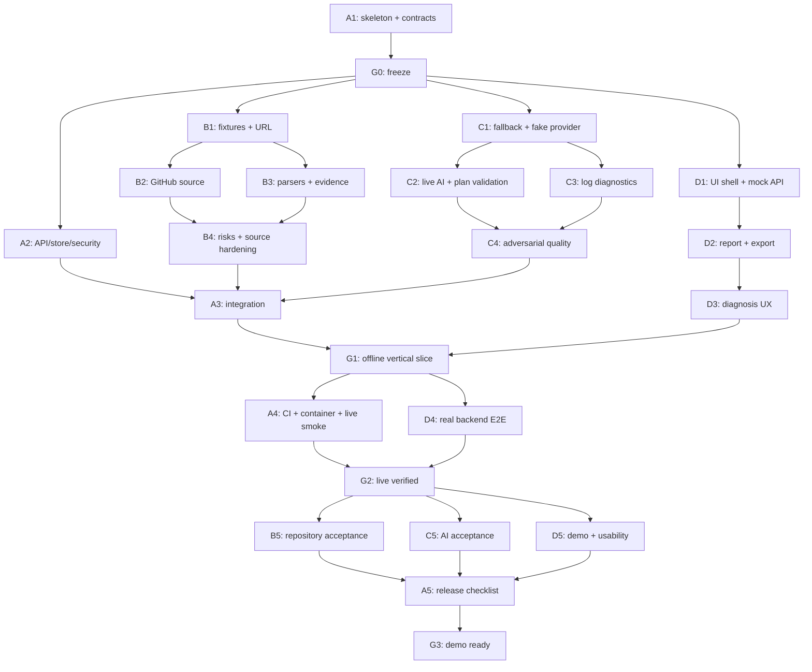

# RepoDoctor — roadmap для четырёх параллельных агентов

Источник технических решений: [ARCHITECTURE.md](ARCHITECTURE.md). Этот файл определяет последовательность, зависимости и владельцев. Все задачи ниже пока запланированы; наличие документа не означает выполнение.

## 1. Роли

| Агент | Роль | Главный результат | Не редактирует самостоятельно |
|---|---|---|---|
| 1 | Platform / Integration Lead | Общие DTO, backend API, безопасность ввода, сборка, CI, запуск | Scanner/AI/frontend бизнес-логику |
| 2 | Repository Engineer | GitHub source, snapshots, evidence, manifests, static findings | API routes, DTO после freeze, AI, UI |
| 3 | AI / Diagnostics Engineer | План запуска, AI provider, fallback, анализ логов | GitHub loader, API routes, frontend |
| 4 | Frontend / Demo Engineer | Рабочий UI, API client, Markdown export, browser E2E | Backend, Python dependencies, общий контракт |

Агент 1 — координатор интеграции, но не исполнитель всех модулей. Агент 4 отвечает за проверку пользовательского пути, но не исправляет сам чужие backend-файлы: оформляет воспроизводимый defect для владельца.

## 2. Правила совместной работы

1. Общий репозиторий, один источник истины контрактов. Предпочтительны четыре ветки и четыре отдельных worktree: `agent-1-platform`, `agent-2-repository`, `agent-3-ai`, `agent-4-frontend`. Это имена будущих веток, сейчас они не созданы.
2. В каждом worktree своя установка зависимостей. Перед созданием веток проверить текущий Git status и наличие repo, сохранить чужие незакоммиченные изменения. Не применять reset/clean к общей папке.
3. До `G0` агент 1 создаёт исходный commit контрактов. Агенты 2–4 стартуют от него. Если Git пока нет, агент 1 инициализирует его в рамках реализации и создаёт первый commit; remote push не требуется для локальной работы.
4. Если работа идёт в одной физической папке, не делать checkout/rebase/reset параллельно. Владение каталогами строгое, commit/lockfile/install-операции согласует агент 1. Один агент не форматирует весь repo через чужие файлы.
5. Python pyproject/uv.lock меняет только агент 1; package.json/package-lock — только агент 4. Новую зависимость запрашивать через handoff с назначением и альтернативой из stdlib.
6. `contracts/api.py`, `domain.py`, `ports.py`, `contracts/examples` и `openapi.json` меняет только агент 1. Generated TS обновляет агент 4 из OpenAPI. Ручные независимые API-типы запрещены.
7. Для изменения контракта: описать проблему → предложить точную field/signature delta → агент 1 принимает решение в decisions.md → обновляет DTO/examples/OpenAPI → сообщает затронутым владельцам → они обновляют код и tests → общий contract check. Не выпускать половину изменения.
8. Каждая задача завершается коротким handoff: изменённые файлы, точные команды проверок, их фактический результат, ограничения, следующий unblock. «Должно работать» не считается проверкой.
9. Не merge непроверенный код ради количества задач. Конфликт разрешает владелец файла с координатором. Merge/rebase идут последовательно; длительные unit-tests разных агентов могут идти параллельно.
10. Агенты-разработчики не запускают дочерних агентов без отдельного решения команды. План рассчитан ровно на четыре независимых зоны работы.

## 3. Граф зависимостей



Внутри одного агента задачи последовательны. Стрелки B1→B2/B3 и C1→C2/C3 обозначают технические зависимости, а не дополнительного пятого/шестого исполнителя: агент 2 делает B2, затем B3; агент 3 делает C2, затем C3. При ожидании доступа можно временно взять следующую независимую задачу, оставив предыдущую честно incomplete.

## 4. Таблица работ

| ID | Владелец | Работа | Входные условия | Передаёт |
|---|---|---|---|---|
| A1 | 1 | Skeleton, DTO, Protocol, примеры, OpenAPI | Прочитана архитектура, пустой/проверенный workspace | G0 commit и contract examples |
| A2 | 1 | Routes, store, limiter, body limits, redaction | A1 | API со stubs и тесты ошибок |
| A3 | 1 | Wiring source/scanner/intelligence | A2, B4, C4 | Рабочий backend для G1 |
| A4 | 1 | CI, сборка, container, live smoke | G1, frontend build от D3 | Воспроизводимый запуск, результаты live |
| A5 | 1 | Release review, runbook, итоговая матрица | B5, C5, D5 | G3 или точный список блокеров |
| B1 | 2 | URL policy, synthetic snapshots, fixture source | G0 | Offline входы для всех |
| B2 | 2 | GitHub metadata/commit/tree/blobs | B1 | Live source на том же Protocol |
| B3 | 2 | Python/Node/readme parsers, evidence | B1; обычно после B2 | StaticAnalysis на fixtures |
| B4 | 2 | Risks, budgets, graceful degradation | B2, B3 | Репозиторный модуль готов к wiring |
| B5 | 2 | Live acceptance и handoff | G2 | Проверенные repo SHA/coverage и ограничения |
| C1 | 3 | Rules fallback и fake provider | G0; fixtures B1 желательны, допускается contract example | PlanResult без внешнего AI |
| C2 | 3 | OpenAI adapter, prompt, validation | C1 | AI план с fallback |
| C3 | 3 | Лог: правила, prompt, доказательства | C1; redaction A2 для интеграции | DiagnosisResult |
| C4 | 3 | Injection/invalid output/failure tests | C2, C3 | Готовый IntelligenceService |
| C5 | 3 | Live AI acceptance и rubric | G2 | Честный отчёт о качестве |
| D1 | 4 | Frontend shell, generated types, MSW | G0 | UI на нормативных mocks |
| D2 | 4 | Report, evidence, commands, export | D1 | Экран результата |
| D3 | 4 | Diagnosis, retry/error states | D2 | Полный пользовательский flow на mocks |
| D4 | 4 | Real-backend E2E и интеграция | G1 | Сквозной браузерный прогон |
| D5 | 4 | Доступность, полировка, demo | G2 | Сценарий защиты и резервный путь |

## 5. Gates — что проверяется перед следующей волной

### G0 — контракты заморожены

Владелец: агент 1. Разблокирует активную параллельную реализацию.

- [ ] Структура backend и frontend zone определена, package import работает.
- [ ] Все public/internal DTO и Protocol из архитектуры реализованы.
- [ ] API examples: Python analysis, Node analysis, fallback/needs_input, diagnosis, ErrorResponse.
- [ ] Каждый example валидируется соответствующим DTO.
- [ ] OpenAPI экспортируется без внешних ключей и сетевых запросов.
- [ ] Доступен backend stub для health/analysis/diagnosis, явно dev-only; он не выдаётся за live.
- [ ] Python версии зафиксированы; агент 4 фиксирует frontend lock в D1.
- [ ] Остальным переданы commit ID, команды установки, пути примеров.

### G1 — целый offline-сценарий

Владелец: агент 1, UI проверяет агент 4.

- [ ] Fixture source → настоящий scanner → настоящий fallback → API → UI.
- [ ] Вставленная ошибка → настоящий sanitizer/rules → diagnosis → UI.
- [ ] Исходный AI stub отключён в production composition; fallback реализован, а не захардкожен.
- [ ] Command shell соответствует target; evidence открывается на корректных путях или честно помечено synthetic.
- [ ] Неподдерживаемый fixture URL не возвращает чужой demo report.
- [ ] Markdown export работает, сырой лог и секреты не попадают в него.
- [ ] HTTP/API/browser tests проходят без GitHub и AI.

### G2 — live-путь и сборка

- [ ] Один Python и один npm public repo прочитаны live, результаты привязаны к SHA.
- [ ] Реальная модель дала план и диагноз; модель/дата/статус записаны. Если нет доступа, live-AI часть gate остаётся blocked, хотя offline демо можно показывать с явной пометкой.
- [ ] Имитированные GitHub rate limit и AI timeout обработаны в тестах.
- [ ] Frontend build, backend tests и browser E2E зелёные.
- [ ] README проверен на чистой установке зависимостей.
- [ ] Container запускается и healthcheck проходит; если Docker недоступен на машине, статус «не проверен», не «passed».

### G3 — можно защищать

- [ ] Репетиция на заранее выбранном repo/ref.
- [ ] Есть живой пример и независимый fixture fallback на случай сети.
- [ ] UI явно показывает режимы и непроверенность выполнения команд.
- [ ] Известные ограничения записаны, P0/P1 нет.
- [ ] Финальный интеграционный commit/tag и инструкции переданы команде.

## 6. Пример расписания на хакатон

Оценка плановая, в часах от начала, не обещание времени исполнения агентами. Адаптировать к длительности мероприятия; gates важнее часов.

| Окно | Агент 1 | Агент 2 | Агент 3 | Агент 4 |
|---|---|---|---|---|
| 0–1.5 ч | A1 и G0 | Подготовить fixture-сценарии | Подготовить diagnostic cases | Подготовить UX состояния |
| 1.5–4 ч | A2 | B1, B2 | C1, C2 | D1, D2 |
| 4–6 ч | API hardening, принимать handoffs | B3, B4 | C3, C4 | D3 |
| 6–8 ч | A3, G1, начать A4 | Исправления интеграции | Исправления интеграции | D4 |
| 8–10 ч | A4, G2 | B5 | C5 | D5 |
| 10–12 ч | A5, G3, резерв | Резерв | Резерв | Репетиция |

Если осталось мало времени: уменьшать оформление, breadth parsers и поддержку редких manifests. Не убирать evidence, границы режимов, обработку ошибок, end-to-end проверку и согласованные DTO. Минимальный защитимый путь — Python + npm fixtures, хотя бы один live repo, честный AI fallback; несделанные live-критерии явно перечислить.

## 7. Формат handoff и блокера

Каждый агент ведёт `docs/handoffs/agent_N.md` только для своей зоны:

```text
Задача: B3
Статус: done | in_progress | blocked
Базовый контракт: schema_version 1.0, commit ...
Файлы: ...
Реализовано: ...
Проверки: команда → фактический результат
Не проверено: ...
Изменения контракта/зависимостей: нет / точное предложение
Разблокирует: ...
Блокер: необходимый артефакт, владелец, воспроизведение
Следующая задача: ...
```

Блокер не означает простаивать: пока нет AI-ключа, писать fake-provider tests; пока не слит loader, использовать fixture; пока нет frontend, проверять API через test client. Но нельзя маркировать live-проверку успешной на основании fixture.

## 8. Интеграция по шагам для координатора

1. Зафиксировать G0 и собрать подтверждение чтения контракта от всех владельцев.
2. Принимать маленькие логические изменения, не ждать конца всего хакатона для первого merge.
3. Сначала подключить B1+scanners и C1 fallback, затем live source/AI. Подмена через DI, не флаги внутри бизнес-логики.
4. Сверить DTO/examples/OpenAPI/TS до подключения UI к backend.
5. Пройти G1 на настоящем backend; MSW полностью выключен.
6. Выполнить G2 в отдельных live-запусках. Не включать платные/сетевые вызовы в обычный CI.
7. Зафиксировать repo commit, target и лог для demo; ручное воспроизведение ошибки отделить от автоматических тестов RepoDoctor.
8. Перед G3 остановить добавление новых функций, закрыть найденные дефекты и обновить инструкции.

## 9. Начальное сообщение каждому агенту

Передать следующий текст, подставив номер и файл руководства:

```text
Ты агент N проекта RepoDoctor. Прочитай ARCHITECTURE.md, ROADMAP.md
и agents/AGENT_N_....md целиком. Реализуй задачи своей роли по порядку.
Сначала проверь фактические файлы, Git status и выполненность prerequisites.
Не считай будущие задачи уже реализованными и не заменяй общий API своим.
Работай только в своей зоне владения; изменения общих контрактов и зависимостей
передавай агенту-владельцу. После каждой задачи запускай нужные проверки и
обновляй docs/handoffs/agent_N.md. При блокере продолжай независимую работу,
но не выдавай mock/fallback за live. Точные промпты задач находятся в твоём файле.
```
