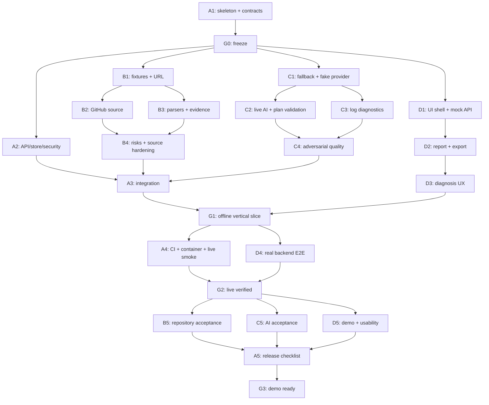

# RepoDoctor — roadmap для четырёх параллельных агентов

Источник технических решений: [ARCHITECTURE.md](ARCHITECTURE.md). Этот файл определяет последовательность, зависимости, владельцев и подтверждённый статус задач. Наличие промпта или каркаса модуля не означает выполнение.

## Текущее состояние — 25.10.2026

Статусы сверены с кодом и handoff-файлами после объединения [PR №6](https://github.com/dendmish/RepoDoctor/pull/6) (`ee2ab9b`, C2/C3), на базе B2–B4 (`0f1a237`). Выполнены **10 из 20 задач: A1, A2, B1, B2, B3, B4, C1, C2, C3, D1**. Волна 1 завершена; в волне 2 завершены B2–B4 и C2/C3, остаются C4 и D2/D3. Из общих этапов закрыт **G0**, G1–G3 остаются открытыми. Работа в других ветках не считается завершённой в `main`.

Проверка объединённого backend после B2–B4: `pytest -q` — **345 passed**; Ruff check/format включают backend и оба exporter-скрипта fixtures (из `backend`, Windows, Python 3.12.3). Проверены transport mocks, шесть цепочек fixture → scanner → fallback C1, все десять risk rules и source-only live smoke на RepoDoctor/Express. Эти проверки не заменяют открытые интеграционные и live-критерии G1–G3; подробности и SHA — в [handoff агента 2](docs/handoffs/agent_2.md).

После C2/C3: `pytest -q` — **446 passed**, из них **157 intelligence tests**; Ruff check — **All checks passed**, format check — **68 files already formatted** (backend и три exporter-скрипта fixtures, Windows, Python 3.12.15). Проверены OpenAI SDK на mock transport, валидация и полный fallback, диагностика лога, шесть scan B3 × три shell, HTTP-путь через DI с настоящими source/scanner/intelligence, redaction и неизменность store. Live OpenAI не проверен: ключ/модель не заданы. Подробности — в [handoff агента 3](docs/handoffs/agent_3.md).

Повторная приёмка frontend D1 (из `frontend`, Windows, Node 22.22.0, npm 11.6.2): `npm ci` — успешно; `npm run generate:api` — без diff generated types; `npm test` — **20 passed**; `npm run build` — typecheck и production build прошли; `npm run test:e2e` — **2 passed** в Chromium (MSW smoke, без настоящего backend). В `dist` отсутствуют worker MSW, `setupWorker` и `synthetic-example-model`. Для проверок использована отдельная временная папка: системный TEMP имеет ограничения доступа.

| Выполнено | Результат | Подтверждение |
|---|---|---|
| A1 | Backend skeleton, DTO/Protocol, examples, OpenAPI, зафиксированные зависимости | `9698dd4`, [handoff агента 1](docs/handoffs/agent_1.md) |
| G0 | Контракты 1.0 заморожены, исходная точка для параллельной работы | `c1b9c8a`, тег `g0`, [чеклист G0](#g0--контракты-заморожены) |
| A2 | API services, TTL/LRU store, limiter, body limit, redaction | `e9d42f7`, [handoff агента 1](docs/handoffs/agent_1.md) |
| B1 | URL/ref policy, шесть synthetic snapshots, fixture source | `1e22e93`, [handoff агента 2](docs/handoffs/agent_2.md) |
| B2 | GitHub metadata/commit/tree/blobs, fixed host/SHA, bounded HTTP и redaction | [handoff агента 2](docs/handoffs/agent_2.md), transport tests и live smoke |
| B3 | Python/Node/README parsers, project roots, реестр evidence и шесть StaticAnalysis examples | [handoff агента 2](docs/handoffs/agent_2.md), scanner/fixture tests |
| B4 | Десять risk rules, budgets, partial coverage и совместимость с fallback C1 | [handoff агента 2](docs/handoffs/agent_2.md), regression tests |
| C1 | Детерминированный fallback-план, provider Protocol и fake для tests | `f4490c3`, [handoff агента 3](docs/handoffs/agent_3.md) |
| C2 | OpenAI Responses adapter, prompts, bounded context, валидация плана и fallback | `3b0155f`, [PR №6](https://github.com/dendmish/RepoDoctor/pull/6), [handoff агента 3](docs/handoffs/agent_3.md); SDK transport mocks, без live AI |
| C3 | Диагностика обработанного лога, log evidence, локальные правила и AI fallback | `3b0155f`, `cc20da2`, [PR №6](https://github.com/dendmish/RepoDoctor/pull/6), [handoff агента 3](docs/handoffs/agent_3.md); unit и HTTP DI tests |
| D1 | React/TypeScript/Vite shell, generated API types, fetch client, формы и MSW | `afefc3b`, [PR №5](https://github.com/dendmish/RepoDoctor/pull/5), [handoff агента 4](docs/handoffs/agent_4.md) |

Следующие доступные задачи: **C4** (агент 3), **D2** (агент 4). B2–B4 и C2/C3 завершены; агент 1 переходит к A3 после C4. Следующая задача агента 2 — B5 после G2. `IntelligenceServiceImpl.diagnose` реализован; OpenAI adapter проверен на mock transport, live AI ещё не проверен. D1 проверяет UI на MSW; полный отчёт, экспорт и диагностика относятся к D2/D3, реальный backend E2E — к D4. Source/scanner/intelligence работают вместе в HTTP DI-тесте, но production wiring A3 и полный UI ещё не подтверждены. Альтернативный MVP из PR №1 не включён в эту архитектуру.

## 1. Роли

| Агент | Роль | Главный результат | Не редактирует самостоятельно |
|---|---|---|---|
| 1 | Platform / Integration Lead | Общие DTO, backend API, безопасность ввода, сборка, CI, запуск | Scanner/AI/frontend бизнес-логику |
| 2 | Repository Engineer | GitHub source, snapshots, evidence, manifests, static findings | API routes, DTO после freeze, AI, UI |
| 3 | AI / Diagnostics Engineer | План запуска, AI provider, fallback, анализ логов | GitHub loader, API routes, frontend |
| 4 | Frontend / Demo Engineer | Рабочий UI, API client, Markdown export, browser E2E | Backend, Python dependencies, общий контракт |

Агент 1 — координатор интеграции, но не исполнитель всех модулей. Агент 4 отвечает за проверку пользовательского пути, но не исправляет сам чужие backend-файлы: оформляет воспроизводимый defect для владельца.

## 2. Правила совместной работы

1. Общий репозиторий, один источник истины контрактов. Предпочтительны четыре ветки и четыре отдельных worktree: `agent-1-platform`, `agent-2-repository`, `agent-3-ai`, `agent-4-frontend`. Это имена будущих веток, сейчас они не созданы.
2. В каждом worktree своя установка зависимостей. Перед созданием веток проверить текущий Git status и наличие repo, сохранить чужие незакоммиченные изменения. Не применять reset/clean к общей папке.
3. До `G0` агент 1 создаёт исходный commit контрактов. Агенты 2–4 стартуют от него. Если Git пока нет, агент 1 инициализирует его в рамках реализации и создаёт первый commit; remote push не требуется для локальной работы.
4. Если работа идёт в одной физической папке, не делать checkout/rebase/reset параллельно. Владение каталогами строгое, commit/lockfile/install-операции согласует агент 1. Один агент не форматирует весь repo через чужие файлы.
5. Python pyproject/uv.lock меняет только агент 1; package.json/package-lock — только агент 4. Новую зависимость запрашивать через handoff с назначением и альтернативой из stdlib.
6. `contracts/api.py`, `domain.py`, `ports.py`, `contracts/examples` и `openapi.json` меняет только агент 1. Generated TS обновляет агент 4 из OpenAPI. Ручные независимые API-типы запрещены.
7. Для изменения контракта: описать проблему → предложить точную field/signature delta → агент 1 принимает решение в decisions.md → обновляет DTO/examples/OpenAPI → сообщает затронутым владельцам → они обновляют код и tests → общий contract check. Не выпускать половину изменения.
8. Каждая задача завершается коротким handoff: изменённые файлы, точные команды проверок, их фактический результат, ограничения, следующий unblock. «Должно работать» не считается проверкой.
9. Не merge непроверенный код ради количества задач. Конфликт разрешает владелец файла с координатором. Merge/rebase идут последовательно; длительные unit-tests разных агентов могут идти параллельно.
10. Агенты-разработчики не запускают дочерних агентов без отдельного решения команды. План рассчитан ровно на четыре независимых зоны работы.

## 3. Граф зависимостей



Внутри одного агента задачи последовательны. Стрелки B1→B2/B3 и C1→C2/C3 обозначают технические зависимости, а не дополнительного пятого/шестого исполнителя: агент 2 делает B2, затем B3; агент 3 делает C2, затем C3. При ожидании доступа можно временно взять следующую независимую задачу, оставив предыдущую честно incomplete.

## 4. Таблица работ

| ID | Статус в main | Владелец | Работа | Входные условия | Передаёт |
|---|---|---|---|---|---|
| A1 | ✅ Выполнено | 1 | Skeleton, DTO, Protocol, примеры, OpenAPI | Прочитана архитектура, пустой/проверенный workspace | G0 commit и contract examples |
| A2 | ✅ Выполнено | 1 | Routes, store, limiter, body limits, redaction | A1 | API со stubs и тесты ошибок |
| A3 | ⬜ Не закрыто | 1 | Wiring source/scanner/intelligence | A2, B4, C4 | Рабочий backend для G1 |
| A4 | ⬜ Не закрыто | 1 | CI, сборка, container, live smoke | G1, frontend build от D3 | Воспроизводимый запуск, результаты live |
| A5 | ⬜ Не закрыто | 1 | Release review, runbook, итоговая матрица | B5, C5, D5 | G3 или точный список блокеров |
| B1 | ✅ Выполнено | 2 | URL policy, synthetic snapshots, fixture source | G0 | Offline входы для всех |
| B2 | ✅ Выполнено | 2 | GitHub metadata/commit/tree/blobs | B1 | Live source на том же Protocol |
| B3 | ✅ Выполнено | 2 | Python/Node/readme parsers, evidence | B1; обычно после B2 | StaticAnalysis на fixtures |
| B4 | ✅ Выполнено | 2 | Risks, budgets, graceful degradation | B2, B3 | Репозиторный модуль готов к wiring |
| B5 | ⬜ Не закрыто | 2 | Live acceptance и handoff | G2 | Проверенные repo SHA/coverage и ограничения |
| C1 | ✅ Выполнено | 3 | Rules fallback и fake provider | G0; fixtures B1 желательны, допускается contract example | PlanResult без внешнего AI |
| C2 | ✅ Выполнено | 3 | OpenAI adapter, prompt, validation | C1 | AI план с fallback |
| C3 | ✅ Выполнено | 3 | Лог: правила, prompt, доказательства | C1; redaction A2 для интеграции | DiagnosisResult |
| C4 | ⬜ Не закрыто | 3 | Injection/invalid output/failure tests | C2, C3 | Готовый IntelligenceService |
| C5 | ⬜ Не закрыто | 3 | Live AI acceptance и rubric | G2 | Честный отчёт о качестве |
| D1 | ✅ Выполнено | 4 | Frontend shell, generated types, MSW | G0 | UI на нормативных mocks |
| D2 | ⬜ Не закрыто | 4 | Report, evidence, commands, export | D1 | Экран результата |
| D3 | ⬜ Не закрыто | 4 | Diagnosis, retry/error states | D2 | Полный пользовательский flow на mocks |
| D4 | ⬜ Не закрыто | 4 | Real-backend E2E и интеграция | G1 | Сквозной браузерный прогон |
| D5 | ⬜ Не закрыто | 4 | Доступность, полировка, demo | G2 | Сценарий защиты и резервный путь |

## 5. Gates — что проверяется перед следующей волной

### G0 — контракты заморожены

Владелец: агент 1. Разблокирует активную параллельную реализацию.

**Статус: выполнен 25.10.2026, тег `g0`. Подробности и команды — [docs/handoffs/agent_1.md](docs/handoffs/agent_1.md).**

- [x] Структура backend и frontend zone определена, package import работает.
- [x] Все public/internal DTO и Protocol из архитектуры реализованы.
- [x] API examples: Python analysis, Node analysis, fallback/needs_input, diagnosis, ErrorResponse.
- [x] Каждый example валидируется соответствующим DTO.
- [x] OpenAPI экспортируется без внешних ключей и сетевых запросов.
- [x] Доступен backend stub для health/analysis/diagnosis, явно dev-only; он не выдаётся за live.
- [x] Python версии зафиксированы; frontend lock и Node/npm baseline зафиксированы в D1.
- [x] Остальным переданы commit ID, команды установки, пути примеров.

### G1 — целый offline-сценарий

Владелец: агент 1, UI проверяет агент 4.

**Статус: частично выполнен; G1 не закрыт.** Реализованы A2/B1–B4/C1–C3/D1. Отметки подтверждают отдельные условия; backend HTTP-путь проверен через DI, сквозной offline-путь через API/UI с настоящими модулями ещё не проверен.

- [ ] Fixture source → настоящий scanner → настоящий fallback → API → UI. **Частично:** шесть fixture → scanner → fallback цепочек и HTTP analysis/diagnosis с настоящими модулями через DI проверены тестами; UI shell работает на MSW. Нужны production wiring A3 и полный report UI D2.
- [ ] Вставленная ошибка → настоящий sanitizer/rules → diagnosis → UI. **Частично:** C3 реализует diagnosis; HTTP DI-тест проверяет A2 sanitizer → настоящие rules → DiagnosisResponse, маскирование секретов и неизменность store. UI диагностики относится к D3, production wiring — к A3.
- [x] Исходный AI stub отключён в production composition; fallback реализован, а не захардкожен. `Settings` запрещает `USE_DEV_STUBS=true` в production; C1 строит план настоящими rules. Подключение fallback к production API остаётся задачей A3.
- [ ] Command shell соответствует target; evidence открывается на корректных путях или честно помечено synthetic. **Частично:** C1–C3 tests подтверждают shell/cwd, evidence IDs и номера строк обработанного лога; проверены шесть scan B3 × три shell, synthetic-режим обозначен. Evidence viewer и его браузерная проверка ещё предстоят в D2.
- [x] Неподдерживаемый fixture URL не возвращает чужой demo report. B1 проверяет `RepositoryNotFoundError`, HTTP-тест dev stub — 404 `REPOSITORY_NOT_FOUND`; production wiring с настоящим source ещё предстоит в A3.
- [ ] Markdown export работает, сырой лог и секреты не попадают в него. **Не выполнено:** exporter и проверки относятся к D2/D3.
- [ ] HTTP/API/browser tests проходят без GitHub и AI. **Частично:** прошли 446 backend-тестов (включая HTTP/API, source/scanner/intelligence и SDK transport mocks), ранее в D1 — 20 frontend-тестов и 2 browser smoke. Последние используют MSW и не подтверждают работу реального offline-конвейера. Сквозной браузерный прогон без MSW ещё не выполнен.

Основания для отмеченных условий и частичного прогресса: `backend/tests/platform/test_app.py::test_dev_stubs_forbidden_in_production`, `backend/tests/platform/test_app.py::test_dev_stub_rejects_unknown_repository`, `backend/tests/repository/test_fixture_source.py::test_unknown_repository_does_not_fall_back`, `backend/tests/intelligence/test_rules.py`, `test_examples.py`, `test_ai.py`, `test_diagnostics.py` и `test_integration.py`. Frontend D1: `frontend/tests/*.test.*` и `frontend/tests/e2e/shell.spec.ts`; сценарии MSW нельзя выдавать за реальный backend E2E или live-проверку.

### G2 — live-путь и сборка

**Статус: не закрыт.** Source-only live GitHub smoke выполнен в B2–B4; live AI, полный HTTP-путь и общая сборка не подтверждены.

- [ ] Один Python и один npm public repo прочитаны live, результаты привязаны к SHA. **Частично:** напрямую через source/scanner прочитаны RepoDoctor (Python+Node) и Express (npm), SHA записаны в handoff агента 2. Проверка собранного API/продукта остаётся A4/B5.
- [ ] Реальная модель дала план и диагноз; модель/дата/статус записаны. Если нет доступа, live-AI часть gate остаётся blocked, хотя offline демо можно показывать с явной пометкой.
- [ ] Имитированные GitHub rate limit и AI timeout обработаны в тестах.
- [ ] Frontend build, backend tests и browser E2E зелёные.
- [ ] README проверен на чистой установке зависимостей.
- [ ] Container запускается и healthcheck проходит; если Docker недоступен на машине, статус «не проверен», не «passed».

### G3 — можно защищать

**Статус: не закрыт.** Финальная приёмка и репетиция ещё не подтверждены.

- [ ] Репетиция на заранее выбранном repo/ref.
- [ ] Есть живой пример и независимый fixture fallback на случай сети.
- [ ] UI явно показывает режимы и непроверенность выполнения команд.
- [ ] Известные ограничения записаны, P0/P1 нет.
- [ ] Финальный интеграционный commit/tag и инструкции переданы команде.

## 6. Пример расписания на хакатон

Оценка плановая, в часах от начала, не обещание времени исполнения агентами. Адаптировать к длительности мероприятия; gates важнее часов.

| Окно | Агент 1 | Агент 2 | Агент 3 | Агент 4 |
|---|---|---|---|---|
| 0–1.5 ч | A1 и G0 | Подготовить fixture-сценарии | Подготовить diagnostic cases | Подготовить UX состояния |
| 1.5–4 ч | A2 | B1, B2 | C1, C2 | D1, D2 |
| 4–6 ч | API hardening, принимать handoffs | B3, B4 | C3, C4 | D3 |
| 6–8 ч | A3, G1, начать A4 | Исправления интеграции | Исправления интеграции | D4 |
| 8–10 ч | A4, G2 | B5 | C5 | D5 |
| 10–12 ч | A5, G3, резерв | Резерв | Резерв | Репетиция |

Если осталось мало времени: уменьшать оформление, breadth parsers и поддержку редких manifests. Не убирать evidence, границы режимов, обработку ошибок, end-to-end проверку и согласованные DTO. Минимальный защитимый путь — Python + npm fixtures, хотя бы один live repo, честный AI fallback; несделанные live-критерии явно перечислить.

## 7. Формат handoff и блокера

Каждый агент ведёт `docs/handoffs/agent_N.md` только для своей зоны:

```text
Задача: B3
Статус: done | in_progress | blocked
Базовый контракт: schema_version 1.0, commit ...
Файлы: ...
Реализовано: ...
Проверки: команда → фактический результат
Не проверено: ...
Изменения контракта/зависимостей: нет / точное предложение
Разблокирует: ...
Блокер: необходимый артефакт, владелец, воспроизведение
Следующая задача: ...
```

Блокер не означает простаивать: пока нет AI-ключа, писать fake-provider tests; пока не слит loader, использовать fixture; пока нет frontend, проверять API через test client. Но нельзя маркировать live-проверку успешной на основании fixture.

## 8. Интеграция по шагам для координатора

1. Зафиксировать G0 и собрать подтверждение чтения контракта от всех владельцев.
2. Принимать маленькие логические изменения, не ждать конца всего хакатона для первого merge.
3. Сначала подключить B1+scanners и C1 fallback, затем live source/AI. Подмена через DI, не флаги внутри бизнес-логики.
4. Сверить DTO/examples/OpenAPI/TS до подключения UI к backend.
5. Пройти G1 на настоящем backend; MSW полностью выключен.
6. Выполнить G2 в отдельных live-запусках. Не включать платные/сетевые вызовы в обычный CI.
7. Зафиксировать repo commit, target и лог для demo; ручное воспроизведение ошибки отделить от автоматических тестов RepoDoctor.
8. Перед G3 остановить добавление новых функций, закрыть найденные дефекты и обновить инструкции.

## 9. Начальное сообщение каждому агенту

Передать следующий текст, подставив номер и файл руководства:

```text
Ты агент N проекта RepoDoctor. Прочитай ARCHITECTURE.md, ROADMAP.md
и agents/AGENT_N_....md целиком. Реализуй задачи своей роли по порядку.
Сначала проверь фактические файлы, Git status и выполненность prerequisites.
Не считай будущие задачи уже реализованными и не заменяй общий API своим.
Работай только в своей зоне владения; изменения общих контрактов и зависимостей
передавай агенту-владельцу. После каждой задачи запускай нужные проверки и
обновляй docs/handoffs/agent_N.md. При блокере продолжай независимую работу,
но не выдавай mock/fallback за live. Точные промпты задач находятся в твоём файле.
```

## 10. Порядок запуска промптов

Сводка графа из раздела 3 и условий «До начала» из руководств агентов. Обозначения: **A** — агент 1 (платформа), **B** — агент 2 (репозиторий), **C** — агент 3 (AI), **D** — агент 4 (frontend), **G** — gate. Промпт каждой задачи находится в `agents/AGENT_N_*.md`.

### Общий порядок

**Волна 0 — каркас (работает только агент 1)**

1. ✅ **A1 — выполнено** · агент 1 — skeleton, DTO, Protocol, examples, OpenAPI, `uv.lock`. Остальные агенты в это время только продумывают fixtures, тестовые логи и UX-состояния, без кода и собственных API.
2. ✅ **G0 — выполнено** · агент 1 — контракты заморожены; всем переданы commit ID, команды установки, пути examples.

**Волна 1 — после G0, четыре агента параллельно**

3. ✅ **A2 — выполнено** · агент 1 — routes, store, limiter, body limit, redaction. Вход: G0.
4. ✅ **B1 — выполнено** · агент 2 — URL policy, synthetic repositories, fixture source. Вход: G0.
5. ✅ **C1 — выполнено** · агент 3 — fallback-план и fake provider. Вход: G0 (fixtures B1 желательны, но не обязательны).
6. ✅ **D1 — выполнено** · агент 4 — каркас UI, generated types, MSW. Вход: G0.

**Волна 2 — модули (внутри каждого агента последовательно)**

7. ✅ **B2 — выполнено** · агент 2 — GitHub source (metadata, commit, tree, blobs). Вход: B1.
8. ✅ **B3 — выполнено** · агент 2 — парсеры Python/Node/README, evidence registry. Вход: B1, обычно после B2.
9. ✅ **B4 — выполнено** · агент 2 — риски, бюджеты, graceful degradation. Вход: B2 + B3.
10. ✅ **C2 — выполнено** · агент 3 — OpenAI adapter, prompts, валидация плана. Вход: C1. Проверено на mock transport; live AI остаётся в C5/G2.
11. ✅ **C3 — выполнено** · агент 3 — диагностика лога. Вход: C1, обычно после C2; redaction из A2 для полного API-пути. Правила и HTTP DI-путь проверены; UI относится к D3.
12. **C4** · агент 3 — injection, invalid output, failure tests. Вход: C2 + C3.
13. **D2** · агент 4 — отчёт, evidence, команды, экспорт. Вход: D1.
14. **D3** · агент 4 — лог, diagnosis, ошибки, retry. Вход: D2.

**Волна 3 — интеграция offline**

15. **A3** · агент 1 — wiring модулей. Вход: A2 + B4 + C4.
16. **G1** · агент 1, UI проверяет агент 4 — полный offline-сценарий. Вход: A3 + D3.

**Волна 4 — live и сборка (параллельно)**

17. **A4** · агент 1 — CI, Docker, compose, live smoke. Вход: G1 + frontend build.
18. **D4** · агент 4 — real backend + browser E2E. Вход: G1.
19. **G2** — live-путь и сборка проверены. Вход: A4 + D4.

**Волна 5 — приёмка (параллельно)**

20. **B5** · агент 2 — live acceptance репозиториев. Вход: G2.
21. **C5** · агент 3 — live AI acceptance. Вход: G2 + ключ OpenAI.
22. **D5** · агент 4 — полировка и сценарий защиты. Вход: G2 (или явно ограниченный live-статус) + demo repo/ref от B5/C5.

**Волна 6 — выпуск**

23. **A5** · агент 1 — release review, README, runbook. Вход: B5 + C5 + D5.
24. **G3** — можно защищать.

### По агентам

| Агент | Последовательность | Где ждёт других |
|---|---|---|
| 1 Platform | A1 → A2 → A3 → A4 → A5 | A3 ждёт B4 и C4; A4 ждёт G1; A5 ждёт B5/C5/D5 |
| 2 Repository | B1 → B2 → B3 → B4 → B5 | B1 ждёт G0; B5 ждёт G2 |
| 3 AI | C1 → C2 → C3 → C4 → C5 | C1 ждёт G0; C5 ждёт G2 и ключ |
| 4 Frontend | D1 → D2 → D3 → D4 → D5 | D1 ждёт G0; D4 ждёт G1; D5 ждёт G2 и данные B5/C5 |

### Главное

- Первым запускается только агент 1 с A1. Остальных подключать после G0.
- Критический путь: A1 → G0 → (B1…B4 ∥ C1…C4) → A3 → G1 → A4 → G2 → B5/C5/D5 → A5 → G3. Отставание агента 2 или 3 задерживает A3.
- Агент 4 до G1 работает на моках и почти никого не ждёт.
- Перед первой задачей агенту отправить сообщение из раздела 9; после каждой задачи агент обновляет `docs/handoffs/agent_N.md`.
- Без ключа OpenAI C5 и AI-часть G2 остаются незакрытыми; демонстрация возможна только в fallback-режиме с явной пометкой.
